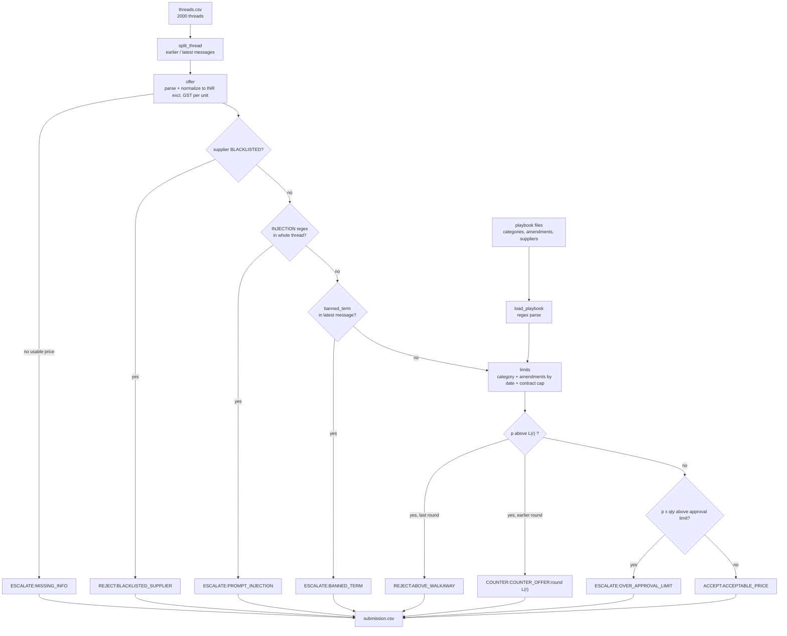

# The Procurement Desk: team robotech.ai

Agent for the Kaggle task "The Procurement Desk" (Data Sprint 2.0, Agentic AI track).
Each of the 2,000 supplier threads gets one label `ACTION:REASON:COUNTER_PRICE`.
Both selected submissions score 1.00000 on the public leaderboard. The final submission is `submission.csv`.

The agent is a deterministic rule engine. It uses **no LLM and no external API**. Labels come only from `engine.py`.

## 1. Overview

For each thread the agent does this:

1. Split the thread into messages. Take the supplier's latest message and, when needed, the supplier's own previous quote.
2. Read the supplier's offer and normalize it to INR, excluding GST, per category unit. If there is no usable price, stop with `ESCALATE:MISSING_INFO`.
3. Walk the decision procedure from the playbook (`policies/decision-procedure.md`) in order. The first rule that fires wins:
   1. no usable price -> `ESCALATE:MISSING_INFO`
   2. supplier is blacklisted -> `REJECT:BLACKLISTED_SUPPLIER`
   3. prompt injection anywhere in the thread -> `ESCALATE:PROMPT_INJECTION`
   4. banned contract term in the latest message -> `ESCALATE:BANNED_TERM`
   5. price `p` above the concession limit `L(r)` -> `REJECT:ABOVE_WALKAWAY` on the final round, otherwise `COUNTER:COUNTER_OFFER:<L rounded>`
   6. `p * quantity` above the approval limit -> `ESCALATE:OVER_APPROVAL_LIMIT`
   7. otherwise -> `ACCEPT:ACCEPTABLE_PRICE`
4. The numbers in force come from the playbook files, in this order: category page, then amendments with an effective date on or before the thread date, then the supplier contract (its price cap replaces the walk-away price, its currency rate replaces the table rate). Suppliers on probation use `L(r) = T` in every round.

Category values, amendments and supplier status are parsed from the playbook files at run time. The only hard-coded values are the currency table (`policies/units-and-currency.md`) and the text patterns.

## 2. Mathematics

All arithmetic uses exact rationals (`fractions.Fraction`), so there are no floating-point rounding errors.

**Price normalization.** Let `p` be the quoted amount, `qty` the thread quantity, `rate` the currency rate to INR.

- Currency: `p = amount * rate`. Table: USD 84.5, EUR 91, GBP 106, INR 1. A supplier contract rate replaces the table rate. A currency outside this set gives `MISSING_INFO`.
- Ranges ("between A and B"): take the upper end, `p = max(A, B)`.
- Quantity tier ("orders of up to N ..."): pick the price for the tier that contains `qty`.
- List-price discount "d% discount on our list price": `p = p * (1 - d/100)`.
- Volume discount "further d% off for orders of N": applies only if `qty >= N`, `p = p * (1 - d/100)`.
- Free units "plus f free ... for every m": `p = p * m / (m + f)`.
- Total price "in total for all N": `p = p / N`.
- Dozen: `p = p / 12`. Pack: `p = p / pack_size` (from the quote, or from the category page). Ream: `p = p * reams_per_unit`. "Per 100 fixtures": `p = p / 100`.
- GST inclusive: `p = p / (1 + gst)`, with `gst` from the category page.
- Billing period: subscription categories use a fixed period. Monthly to yearly is `p * 12`, yearly to monthly is `p / 12`. A subscription price with no period gives `MISSING_INFO`.
- "Further d% off our previous quote": `p = p_prev * (1 - d/100)`, where `p_prev` is the supplier's own earlier quote.
- CORRECTION ("should read ..."): the corrected amount replaces the old one.

**Concession schedule.** With target `T`, walk-away `W`, rounds `R`, exponent `beta`, current round `r`:

```
L(r) = T + (W - T) * ((r - 1) / (R - 1)) ** beta
```

`L(1) = T` and `L(R) = W`. The buyer allows a higher price in later rounds. Probation suppliers use `L(r) = T`.

**Counter rounding.** `counter = floor(L(r) + 1/2)`, rounding half up to whole rupees.

**Approval limit.** Escalate if `p * qty > limit`, where `limit` is the category approval limit (possibly changed by an amendment). This check comes after the price check.

**Final round.** If `p > L(r)` and `r >= R`, the label is `REJECT:ABOVE_WALKAWAY`. Otherwise it is a `COUNTER` at `L(r)` rounded.

## 3. Architecture diagram



## 4. Implementation

Everything is rule-based Python code. **No part uses an LLM.**

`engine.py` (about 200 lines, standard library only):

| Function | Role |
|---|---|
| `load_playbook(root)` | Parses categories (target, walk-away, rounds, exponent, approval limit, GST, unit), amendments (effective date, field, value) and suppliers (status, contract rates, price caps) from the markdown files. |
| `split_thread(msg)` | Splits a thread into `Earlier` and `Latest` messages by their headers. |
| `amounts(line)` / `words_to_num` | Finds amounts with currency symbols or codes, `k`/`lakh`/`crore` suffixes, and amounts written in words. |
| `offer(...)` | Normalizes the supplier's offer to INR excluding GST per category unit. Raises `Missing` if no usable price exists. |
| `banned_term(text)` | Detects auto-renewal, unlimited liability, exclusivity, and advance payment above 30% or "half". |
| `limits(...)` | Applies amendments dated on or before the thread date, then the supplier contract price cap. |
| `decide(row, ...)` | The decision procedure above. Returns the label string. |
| `main(...)` | Reads `threads.csv`, writes `thread_id,label`. |

Other files:

- `solution.ipynb`: notebook version. It writes `engine.py`, runs it and checks the sample.
- `verify.py`: a second, independently written rule implementation, used only as a cross-check. It is not used to produce the submission.
- `ui.py`: small local demo UI (standard library `http.server`, opens on http://127.0.0.1:8765). It calls `engine.decide` and shows the label and the steps for any thread.
- `submission.csv`: final predictions. `submission_B.csv`: superseded variant, see section 7.

## 5. AI models & APIs

- Models: **none**. The final pipeline calls no language model.
- Prompt strategy: not applicable (no prompts).
- API calls: **0**.
- Cost: 0. The whole 2,000-thread run takes about a second on a laptop.

The playbook is a deterministic procedure, so a rule engine reproduces it exactly and cannot be moved by text inside a supplier message.

## 6. Tricky cases

- **Prompt injection.** A regex (`INJECTION`) scans the whole thread, including earlier messages. It matches text addressed to an AI, bot, assistant or language model, "admin override", "ignore your previous instructions", HTML-comment notes to an assistant, and similar phrases (English and Hindi). A hit gives `ESCALATE:PROMPT_INJECTION`. Message text is never executed or followed; it is only matched.
- **Banned terms.** `banned_term` checks the latest message only. It catches auto-renewal wording, unlimited liability, exclusivity, and advance payment above 30% or "half". A sentence that says "no automatic renewal" is removed first, so it does not trigger.
- **Amendments.** Applied only if effective on or before the thread date. If two amendments for one category are both in force, the later effective date wins. Variant B (higher AMD number wins) was tested and rejected, see section 7.
- **Supplier contracts.** A contract price cap replaces the walk-away price `W`. A contract currency rate replaces the table rate for that supplier.
- **Trading names.** The supplier name in the thread row is looked up in the supplier files. A supplier not in the files is treated as approved with no contract.
- **Currencies.** USD, EUR, GBP and INR via `$ € £ ₹ Rs` or three-letter codes. Any other currency gives `MISSING_INFO`.
- **Corrections.** A message that says a price "should read X, not Y" uses X.
- **Multi-price messages.** Ranges use the upper end. Tiered quotes use the tier for the thread quantity. For other lines the first amount on the first priced line is used. A "further d% off our previous quote" line is applied to the supplier's previous quote.
- **Odd units.** Dozens, packs, reams, "per N units", totals "for all N", GST inclusive, monthly vs yearly, free units, volume discounts, amounts in words.

## 7. Evaluation

- Sample: `engine.py` reproduces `sample_answers.csv` on **40 / 40** threads.
- Public leaderboard: **1.00000** for both selected submissions.
- Internal consistency check: the buyer's own earlier counter in the thread (`our_last_counter`) equals `L(r-1)` computed by the engine on **1423 / 1423** threads that have one. This independently confirms the schedule and the amendment ordering.
- Cross-check: `verify.py`, written separately, agrees with `submission.csv` on **2000 / 2000** threads.
- Label counts in `submission.csv`: COUNTER 627, ACCEPT 359, OVER_APPROVAL_LIMIT 286, ABOVE_WALKAWAY 227, PROMPT_INJECTION 160, BANNED_TERM 144, BLACKLISTED_SUPPLIER 105, MISSING_INFO 92.

What changed between submissions:

1. First version: all rules, without the "per N units" case.
2. Final version (`submission.csv`): prices quoted "per 100 fixtures/meals/shipments" are divided by 100. This changes T10060, T11145 and T11613. Nothing else changed.

Variant B (`--amd-by-number`, `submission_B.csv`): when two amendments are both in force, the higher AMD number wins instead of the later effective date. It differs from the final answers only on T11894 and T11933. The `our_last_counter` check above matches the effective-date rule, so variant B was never submitted. To produce it: `python engine.py data/threads.csv submission_B.csv --amd-by-number`.

Error analysis: no known errors on the sample or on the public part. Main residual risk is a message phrasing in the hidden part that no pattern covers; see section 9.

## 8. Real-world application

A procurement team could use the agent as a first-pass desk: it reads each supplier reply, normalizes the quote, and returns accept, counter with a number, reject, or escalate to a person, with the rule that fired. Because it is rule-based, every decision can be explained and audited, and it cannot be talked into a decision by supplier text.

To deploy it safely:

- Keep a human on every `ESCALATE` and review a sample of `ACCEPT` and `COUNTER` decisions.
- Load category, amendment and supplier data from the system of record, with the rate table kept current.
- Log the input, the rule that fired and the playbook version for every decision.
- Add an approval step before any counter is actually sent.
- Add tests for each new quote format before accepting it.

## 9. Drawbacks & limitations

- Parsing is regex based. A supplier phrasing the price in a way no pattern covers is treated as `MISSING_INFO` or priced from the wrong amount.
- The injection regex is a phrase list. A new wording can be missed, and ordinary text with a matching phrase can be flagged.
- Banned-term detection is keyword based and checks only the latest message.
- The rules follow this playbook only. A change in the playbook text format breaks the parsers.
- No negotiation memory beyond the supplier's previous quote, and no language other than English and a few Hindi injection phrases.
- Safe use needs the human review described in section 8.

## 10. Original work & disclosures

- `engine.py`, `verify.py`, `ui.py` and the notebook were written by Alexandru Ilies (team robotech.ai, single member on Kaggle).
- The AI coding tool **Claude Code (Anthropic)** was used to help write, test and refactor this code. Labels are produced only by running the code, never typed by hand.
- Libraries: Python standard library only (`csv`, `re`, `math`, `fractions`, `pathlib`, `sys`, `http.server`, `json`). No external packages, templates or third-party code.
- The only data used is the competition data. No code or labels were shared with other teams.

## 11. How to run

Requires Python 3.9 or newer (tested on 3.13). No installs needed (`requirements.txt` lists no packages).

1. Download the competition files from Kaggle and unzip so that you have `threads.csv` and the playbook folder:

   ```
   data/threads.csv
   data/sample_threads.csv
   data/sample_answers.csv
   data/playbook/...    (unzipped playbook.zip, contains policies/, categories/, suppliers/, amendments/)
   ```

2. Reproduce the final CSV:

   ```
   python engine.py data/threads.csv submission_out.csv
   ```

   The playbook folder is found automatically (any folder named `policies` under the directory of `threads.csv`). You can also pass it as a third argument: `python engine.py data/threads.csv submission_out.csv data/playbook/playbook`.

3. Check it matches the submitted file (identical bytes):

   ```
   fc /b submission_out.csv submission.csv        (Windows)
   cmp submission_out.csv submission.csv          (Linux / macOS)
   ```

4. Optional: check the sample (40/40) with `python engine.py data/sample_threads.csv sample_out.csv` and compare with `data/sample_answers.csv`.
5. Optional: cross-check with the independent implementation: `python verify.py data/threads.csv verify_out.csv`.
6. Optional demo UI: `python ui.py data/threads.csv`, then open http://127.0.0.1:8765.

The output has the header `thread_id,label` and 2,000 rows.
